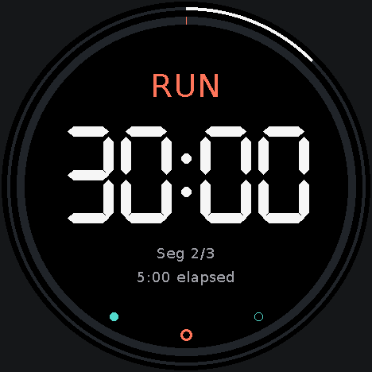
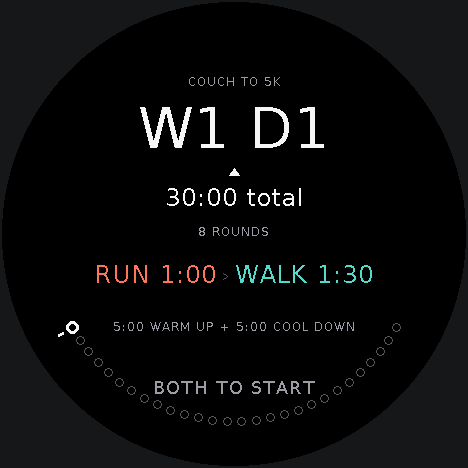
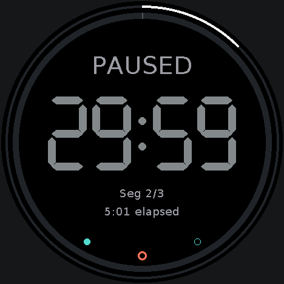
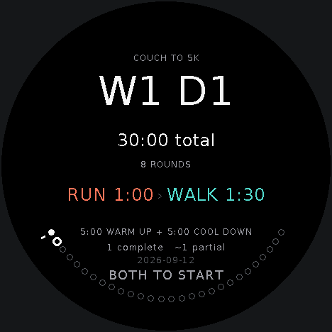

# E25K — ESP to 5K

An offline Couch-to-5K interval trainer for the M5Stack StopWatch C152.
27 workouts. Two buttons. One big countdown.

Choose a workout, press both buttons, and follow the countdown through warm-up, running, walking, and cool-down.
The whole nine-week program lives on the device.

The [project plan](SPEC.md) is the source of truth for workout behavior, controls, and saved data.
It includes the current decisions and the checks still open.

The design starts with a glance: what am I doing, and how much longer?
Every screen is true black with off-white numerals, small muted labels, and periwinkle accents.
The countdown gets a 122-pixel glyph line with stable, equal-width digits.
LVGL 9.3 renders anti-aliased text, circles, and progress arcs, while M5Unified handles the hardware.



E25K began as [ESPtember day 12](https://esptember.com/day/day-12-c25k/).
This repository contains the standalone firmware and its development history.
The source was extracted from [the verified Day 12 build](https://github.com/chantastic/esptember/tree/5edfd18/days/day-12-c25k), preserving its five development commits.
It measures time and saves completed sessions locally.
It uses neither distance nor GPS, and needs no account or network connection.

## What you need

- **Board:** [M5Stack StopWatch C152](https://docs.m5stack.com/en/core/StopWatch), with an ESP32-S3, 16 MB flash, and 8 MB PSRAM.
- **Connection:** a USB data cable and a computer with access to its serial port.
- **For the download:** [uv](https://docs.astral.sh/uv/getting-started/installation/) supplies the `uvx` command below.
- **For source builds:** [Arduino CLI](https://arduino.github.io/arduino-cli/latest/installation/) and the pinned libraries listed below.

The nominal 466 × 466 round AMOLED uses a 468 × 468 drawing surface in the installed driver.
Hold the device with its lanyard loop at the bottom.
Touch is ignored; the yellow and blue buttons handle every screen.

## Flash it

Download [day-12-c25k.bin](https://esptember.com/firmware/day-12-c25k.bin) and open a terminal in the download directory.
This is a 16 MiB merged image for a fresh installation: bootloader, partition table, and application.
Writing it replaces the installed firmware and saved flash data.
For an update that preserves saved C25K history, use the source-build script below.

Find your serial port:

```sh
# macOS
ls /dev/cu.usbmodem*
# Linux
ls /dev/ttyACM*
```

On Windows, use the board's COM port from Device Manager.
Close any serial monitor, replace `PORT` with your port, and flash at `0x0`:

```sh
uvx esptool --chip esp32s3 --port PORT \
  write-flash 0x0 day-12-c25k.bin
```

The board restarts on W1 D1.
Press both buttons to begin.

## Learn four gestures

| Gesture | On a page | During a workout |
| --- | --- | --- |
| Blue click | Next | Skip to the next segment |
| Yellow click | Previous | Restart this segment; click again within two seconds to go back |
| Press both, then release | Enter | Pause or resume |
| Hold both for 600 ms | Escape | Open cancel confirmation |

For Enter, press the buttons together, keep them down briefly, then release both.
The firmware allows 80 ms between presses and requires at least 80 ms of overlap.
A held pair produces Escape once; releasing it cannot also produce Enter.

Home pages through W1 D1 to W9 D3, then History, and wraps at either end.
Home's outer ring has one segment per workout; the wider gap at the top is History.
The triangle and a dim-blue segment mark the next-up workout.
Browsing leaves it in place; Enter starts whichever workout is visible.
A small dot inside the ring marks the page you're viewing.

Ring segments share one legend:

| Segment | Meaning |
| --- | --- |
| Periwinkle | Complete (or passed, during a workout) |
| Dim blue | Current segment or next-up workout |
| Dark grey | Incomplete |

A workout turns periwinkle when the retained history includes at least one full completion; partial-only workouts stay grey.
The next-up color takes precedence when a completed workout is next again.
At program completion, the next-up marker disappears and the final workout uses its completion state.

Each workout shows its total time and a preview of the run/walk sequence before you start.
Read the activities left to right, then top to bottom; matching sequences show how many rounds to repeat.
W1 D1 is eight rounds of a one-minute run and a ninety-second walk, with a five-minute warm-up and five-minute cool-down, for thirty minutes total.



During a workout, the ring has one arc per interval, sized by its share of the session.
Passed intervals are periwinkle; the current one fills as it counts down.
The Complete screen shows which intervals finished; skipped ones stay grey.
Blue and Yellow still work while paused, and leave the timer paused.



Hold both to open cancel confirmation, release, then hold both again to discard the session.
The timer keeps running underneath unless already paused.
Any other input dismisses the overlay; it also disappears after five seconds.

## Finish, repeat, or start over

All 27 workouts include a five-minute warm-up and five-minute cool-down.
The program starts with one-minute runs and reaches a thirty-minute run in week nine.
The complete interval table is in the [design spec](SPEC.md).

A completed session saves its workout, date, active duration, and time spent running.
Skipping forward marks it partial with `~`, including skipping past the final segment.
Going back adds the time you replay without marking the session partial.
Cancellation saves nothing.

Every completion moves the cursor to the workout after the one just finished.
Repeat W2 D1 while the cursor is on week five, and your next-up workout becomes W2 D2.
W9 D3 stays at the end and shows Program complete.



History keeps the newest 256 sessions, including repeats.
Hold both on Home for Settings: Sound, Vibration, Set Time, Reset Progress, and About.
Sound and vibration can be toggled independently; both include the ten-second warning cue.
Reset Progress requires confirmation and clears the history and cursor while keeping those feedback preferences.
On the confirmation page, briefly press both buttons and release to reset; holding both cancels.
Success shows **History cleared**.
Press both again to return Home with W1 D1 next.
If the save cannot be verified, the current progress stays in memory and the screen offers a retry.

Set Time steps through hour, minute, and confirmation.
It preserves the RTC date; an unset clock uses the build date shown on confirmation.
This build converts local RTC time using Pacific time rules.
An unset RTC produces `--` in History and still allows workouts.
The [build guide](BUILD.md) covers setting the full date and changing the timezone.

## Count the time you spend

The RTC supplies log timestamps.
The workout timer uses `millis()` and keeps actual active time separate from position in the planned workout.
That distinction matters the moment you replay a segment.

This excerpt from `session.h` attributes each interval to the segment it belongs to:

```cpp
const uint32_t consumed = delta < remaining ? delta : remaining;
segmentElapsedMs += consumed;
totalElapsedMs += consumed;
if (currentSegment().type == SegmentType::Run) runElapsedMs += consumed;
delta -= consumed;
```

The loop consumes time up to each boundary before moving on.
A delayed screen update can cross a boundary without assigning walking time to a run.
Paused time contributes to neither total.

Completion writes the log and cursor together in one versioned NVS blob.
Workout circles are derived from that retained log; segment circles live in memory for the current session.
The circle update uses the existing storage schema without changing saved data.
A power loss during a workout loses that session and leaves the saved cursor unchanged.

## Check the result

- Start W1 D1 and confirm that WARM UP counts down from five minutes.
- Press both to pause. The label changes to PAUSED and the countdown stops.
- While paused, try Blue, then Yellow twice. Navigation should work without resuming.
- Resume, open cancel confirmation, and confirm that timing continues underneath.
- Complete or skip through a session, then restart the device and check History.

**Recorded evidence · September 12, 2026:** The firmware was flashed to the StopWatch with upload hashes verified.
Automated device checks completed all 27 workouts with accelerated time and exercised pause, navigation, cancellation, partial sessions, and cursor movement.
A saved completion and feedback settings survived reboot; the synthetic history was then cleared.
Framebuffer captures were inspected with a circular display mask.

A separate 125-second real-time check crossed warm-up → RUN → WALK and counted exactly 60 seconds of running.
The largest observed main-loop gap in that timing window was 68.2 ms.
This was a short device check, not a full workout or battery test.
Physical button feel, audible/haptic cues, and daylight readability still need a check in hand.

## Build and change it

Clone E25K, then install the tested dependencies:

```sh
git clone https://github.com/chantastic/E25K.git
cd E25K
arduino-cli core update-index --additional-urls https://espressif.github.io/arduino-esp32/package_esp32_index.json
arduino-cli core install esp32:esp32@3.3.10 --additional-urls https://espressif.github.io/arduino-esp32/package_esp32_index.json
arduino-cli lib install --no-deps "M5Unified@0.2.19" "M5GFX@0.2.26" "lvgl@9.3.0"
```

Run from the repository root, replacing `PORT` with the StopWatch's port:

```sh
scripts/test.sh
scripts/flash.sh PORT
```

The host tests use macOS `clang++` with address and undefined-behavior sanitizers.
The build script applies the repository's LVGL configuration to the sketch and the library.
The generated countdown font is included; normal builds need no font-generation tools.
The flash script builds and uploads individual components using 16 MB flash, OPI PSRAM, and the existing `app3M_fat9M_16MB` partition layout.
With that layout already installed, it preserves saved C25K history.
The merged download is produced at `.build/firmware/c25k.ino.merged.bin`.

Change the program in `workouts.h`, the four-gesture grammar in `buttons.h`, and the drawing in `ui.h`.
The ten-second warning follows the Sound and Vibration toggles.
The display stays at full brightness, and page changes are immediate to leave time for button polling.

[Read the build story](https://esptember.com/day/day-12-c25k/story/) for the button rules, visual decisions, and bugs caught during verification.

## What we learned

A useful timer has more than one kind of progress.
The ring tells you where you are.
The log remembers the time you put in, including the parts you repeated.

## LVGL interface

Version 1.1 replaces the custom full-screen renderer with retained LVGL labels, arcs, switches, and circle shapes.
The workout engine, four button gestures, program, and saved-data format remain unchanged.
Small text uses anti-aliased Montserrat, and the countdown uses tabular Roboto Condensed numerals.
See [font sources and regeneration](assets/fonts/README.md).

LVGL transfers changed areas instead of repainting the whole display on every timer update.
This makes styling and future UI changes easier; battery-life improvements are not yet measured.
